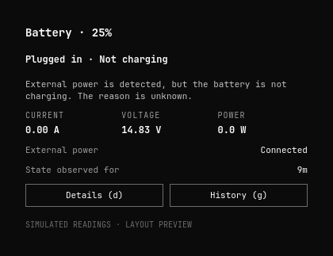
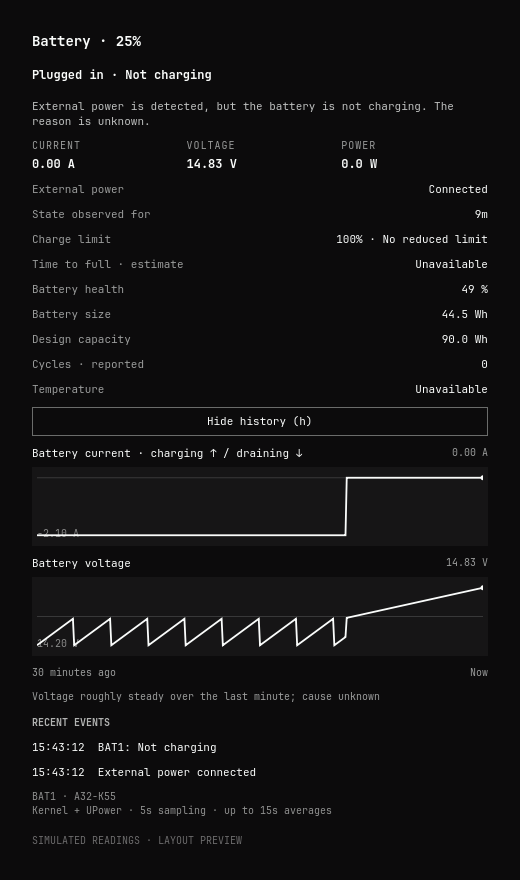

# power-byxax

**A clearer Omarchy battery panel: see whether power is flowing, how much, and what changed.**

Based on Omarchy's official `omarchy.power` plugin, with the original power-profile
controls and theme styling. Replaces the ambiguous “Holding” status with labels
based on the readings your laptop actually provides.



## What it shows

| State | Meaning |
|---|---|
| Charging | The battery reports charging; measured flow is shown when available. |
| Charging slowly | Small positive charging current persists for at least 10 seconds. |
| Plugged in · Not charging | External power is detected; the battery reports a pause. Cause unknown. |
| Charge limit reached | A reduced limit is configured, the battery is at that limit, and no charging flow is measured. |
| Battery draining on AC | External power is detected, but the battery reports discharge. |
| Readings disagree | Connection, status, or flow readings conflict. |
| Telemetry unavailable | The collector has not supplied a reading for over 20 seconds. |

- Current, voltage, and power update every **5 seconds**, with up to **15 seconds of averaging** within the same battery state. Small currents use **mA**.
- Select individual batteries on laptops with multiple packs. Battery names are discovered automatically.
- Keep the default view compact. Press **d** for the charge limit, health, full/design capacity, reported cycles, temperature, and data-source details.
- Press **g** or click **Show history** for current/voltage graphs and recent connection/state changes.
- Details and history collapse when you close the popup, so it reopens in the compact view.
- History covers the last **30 minutes**, survives shell reloads, and marks observation gaps. Graphs are created only while open.
- Several observed AC changes within two minutes show a **Power connection unstable** notice. This does not diagnose a cable, jack, or charger fault.

<details>
<summary>History preview</summary>



Previews use simulated readings and are labelled accordingly. The installed panel uses live readings.
</details>

## Install

Requires **Omarchy 4.0.4 or a compatible later Quickshell shell**, and **Python 3**.
There are no third-party Python dependencies. Standard Linux sysfs readings are
preferred; `busctl` reads UPower properties as a fallback. The panel requires
Omarchy and is not a standalone widget for other desktops.

```sh
omarchy plugin add https://github.com/houtvongsak/power-byxax.git --enable --yes
```

The plugin takes the built-in power widget's place. Left-click opens it;
right-click toggles the bar percentage. Existing power-profile buttons remain.
Scroll the popup if expanded history is taller than the screen.

```sh
omarchy plugin update io.github.houtvongsak.power-byxax
omarchy restart shell  # load the updated QML and collector
omarchy plugin remove io.github.houtvongsak.power-byxax  # restores the stock widget
```

This Omarchy shell version can retain cached QML/IPC handlers after a plugin
rescan. Restart the shell after code updates; updating files alone may leave the
old implementation running.

## Readings and local history

Monitoring runs while the widget is loaded, including when its popup is closed.
It does not install a system service. Nothing is sent online by the collector.
Samples stay in memory; compact history is checkpointed once a minute, immediately
on recorded events, and on normal shutdown. An abrupt crash can lose up to the
latest minute. Supplementary UPower data is cached for 30 seconds on hardware
with complete kernel readings; fallback measurements and connection/state changes
trigger fresh queries.
The bounded history file is private to your user:

```text
${XDG_STATE_HOME:-~/.local/state}/power-byxax/history.json
```

A single snapshot, without writing history:

```sh
python3 bin/telemetry.py
```

The installed panel also exposes its interpreted status:

```sh
omarchy-shell omarchy.power status
```

Missing readings show **Unavailable**, not zero. An ≈ marks current estimated
from watts ÷ volts. UPower's configured threshold values alone do not establish
that a limit is enabled; the kernel setting takes precedence. Firmware can report
inaccurate values, including a zero cycle count. Health is reported full capacity
relative to design capacity, not a hardware diagnosis.

Current and voltage trends cannot prove pre-charge recovery, thermal protection,
or a faulty jack. CPU temperature is not substituted for battery temperature.
Sampling may miss very short connection changes; suspend/logout periods contain
no observations. Persistent history requires a writable state directory; live
readings continue with an error notice if saving fails.

## Development and updates

```sh
bin/check    # scenario tests, syntax, manifest, QML parsing
bin/smoke    # real Quickshell panel + two live samples; requires an Omarchy session
```

The collector and decision tests use simulated hardware and need only Python 3,
Node.js 18+, and Git. QML parsing additionally uses Qt 6's `qmlformat`.
For an isolated layout preview, without capturing your desktop:

```sh
python3 bin/telemetry.py > /tmp/power-snapshot.json
bin/preview /tmp/power-snapshot.json /tmp/power-preview.png --history
```

GitHub Actions checks every push/PR. A separate job checks official Omarchy
releases every Monday at **04:00 UTC**. It updates `upstream`, merges into `main`,
runs the checks in a read-only job, and passes validated Git objects to a separate
publisher. The publisher checks the exact commits and repository state without
checking out or executing candidate code, then publishes a patch release. Conflicts
or failures open a GitHub issue with the workflow link; this workflow does not
create update PRs. GitHub's repository watch/notification settings control whether
you receive notifications for issues and releases. Updates reach installed users
through `omarchy plugin update`.

The initial baseline is [Omarchy v4.0.4](https://github.com/basecamp/omarchy/tree/v4.0.4/shell/plugins/panels/power),
commit `c668141e9c42b13c80c9ca4ea108e11708c5e8a5`. The `upstream` branch holds
the stock plugin and original license; `main` adds this plugin's identity,
telemetry, diagnostics, and UI. Upstream changes to this repository’s automation
or tests require manual review. See [MAINTAINING.md](MAINTAINING.md).

## License

MIT; see [LICENSE](LICENSE). Original Omarchy code by David Heinemeier Hansson.
